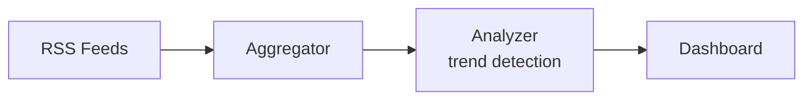

<div align="center">

  

# 📡 AI Trend Tracker

### Real-time AI news aggregation and trend analysis

[](https://www.python.org/)
[](#)
[](LICENSE)

</div>

---

## What is it?

An AI trend tracker that aggregates news from RSS feeds, analyzes trends,
and surfaces what matters in the AI space.

## Features

- 📡 RSS feed aggregation from multiple AI sources
- 🔍 Trend detection and analysis
- 📊 Dashboard for browsing trends
- ⚡ Real-time updates

## Quick Start

```bash
pip install -r requirements.txt
python main.py
```

## Architecture



## Honest limitations

- Depends on RSS feed availability.
- Trend analysis is keyword-based (no LLM yet).

## License

MIT

<div align="center">
  
</div>
